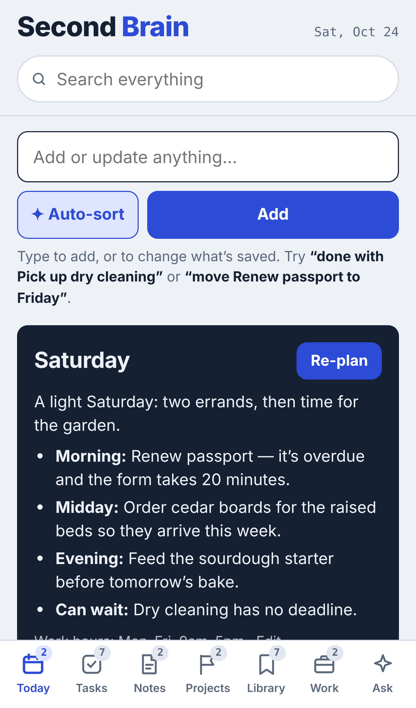
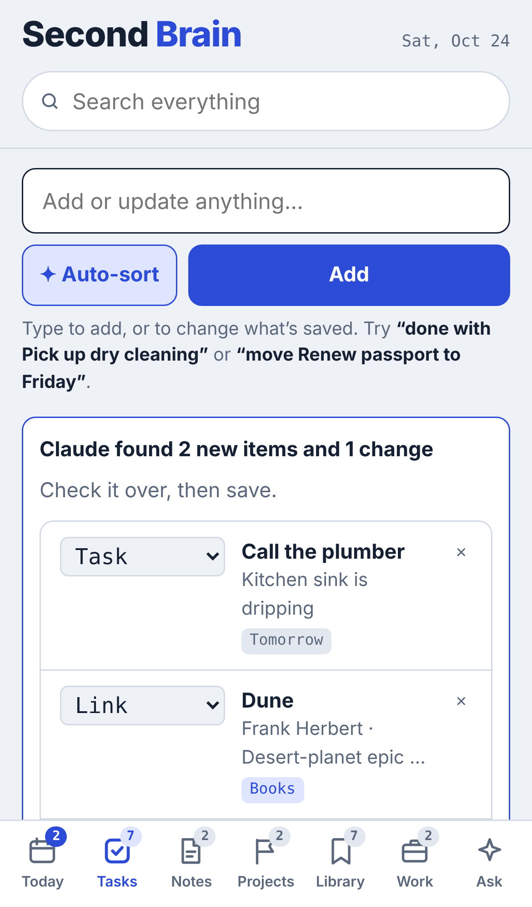
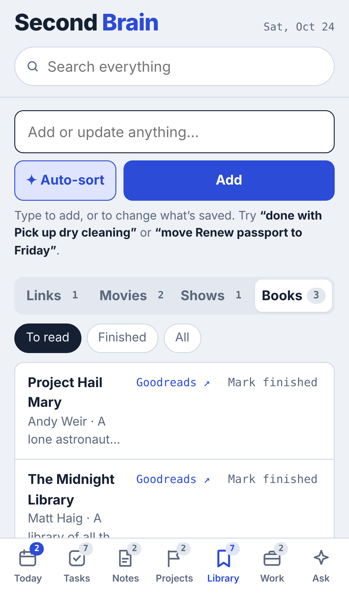
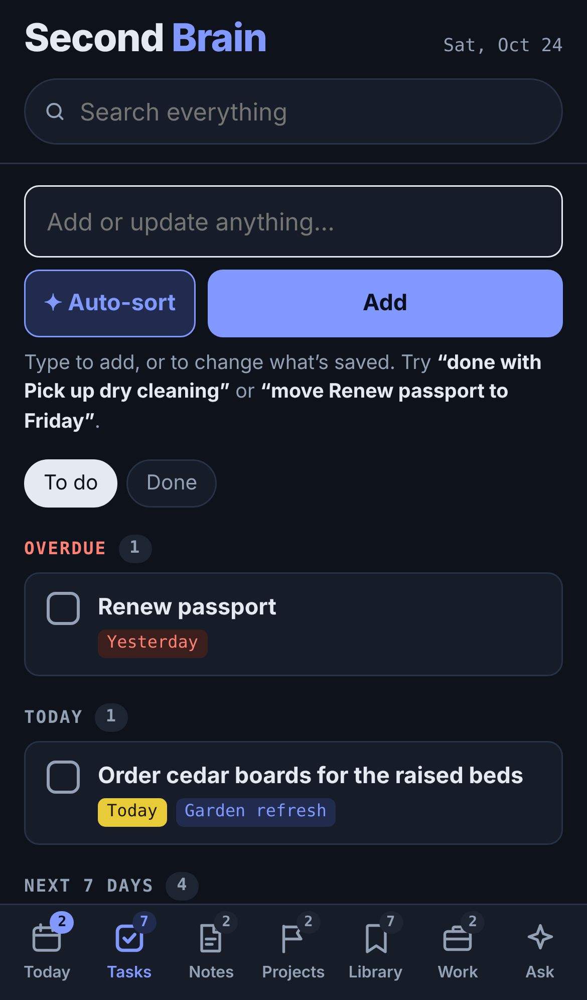
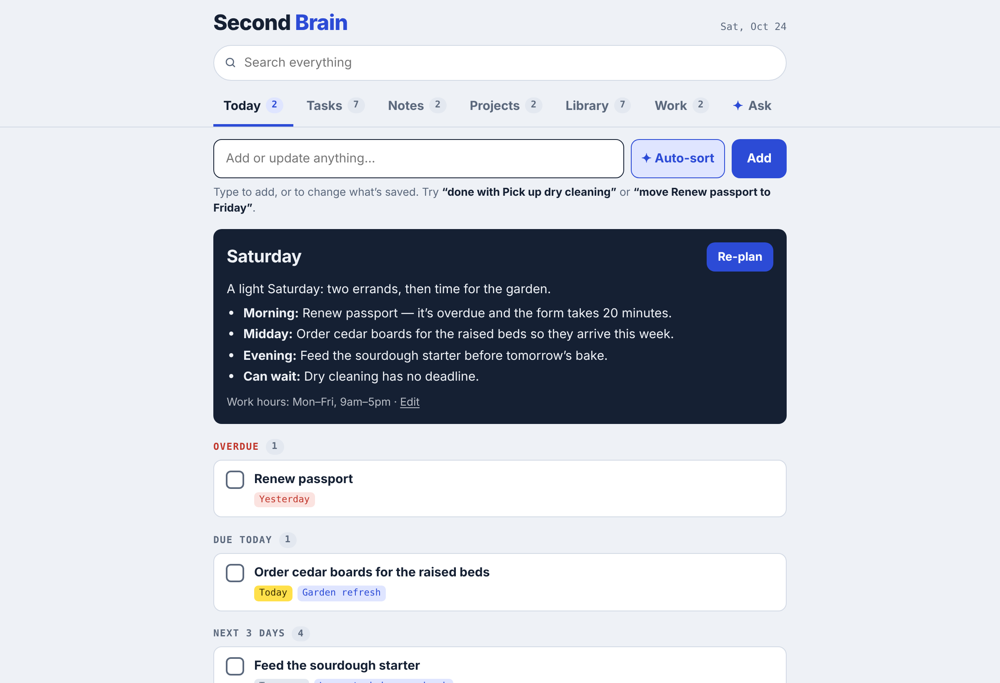

# Second Brain

A personal second brain that lives inside [Claude](https://claude.ai) as an artifact. It keeps your tasks, notes, projects, work thoughts and a library of links, movies, shows and books in one place, and uses Claude to file, update and plan around everything you save.

It's a single `index.html` file. Your data stays in your own Claude account, not in this repo.

<p>
  
  
  
</p>

*Screenshots use made-up demo data.*

## What it does

| | |
|---|---|
| **Today** | What's overdue, due today, reminders, the next few days, pinned work notes and active projects. **✦ Plan my day** writes a short plan that respects your work hours and the time of day. |
| **Tasks** | Grouped into Overdue, Today, Next 7 days, Later and No date. Anything with a due date shows up here, including notes, work items and books, tagged with where it came from. |
| **Notes and Projects** | Free-form notes, plus projects that show progress from their linked tasks. |
| **Library** | Four lists: **Links**, **Movies**, **Shows** and **Books**, each with to-do and done views. New movies, shows and books get a one-line description, the author for books, and a link to IMDb or Goodreads. Untitled links get a readable title. |
| **Work** | A scratchpad for job thoughts, tagged Idea, Follow-up, Reference or Question. Pin the ones you keep coming back to. |
| **Ask** | Ask questions about everything you've saved, or tell it to add, reschedule or tick things off. It can add and change items but never deletes them. |

### Smart capture

Type anything into the box at the top with **✦ Auto-sort** on:

> call the plumber tomorrow, add Dune to my books, move the dentist to Thursday

Claude splits it into separate items, files each one in the right section with dates, tags and lists, and spots changes to things you've already saved. You see a preview first, and nothing saves until you tap **Save**. It can also move an item to another section, rewrite notes, or delete something. Deletes are always shown in red and need your confirmation.

Every item's edit screen also has a **✦ Change with Claude** box ("due Friday, remind me Thursday") and a **Section** picker.

### Reminders

Any item can have a **Remind me on** date. Reminders show on the Today tab until you dismiss them. The page can't send phone notifications by itself.

### Built for phones

On narrow screens, a bottom tab bar keeps every section in thumb reach. It has light and dark themes, and there's a quick-capture view for a home-screen shortcut.

<p>
  
</p>


## Setting it up

The page uses two features of Claude artifacts: a private **database** for your items, and **Claude** itself for the smart features. It only works inside Claude (claude.ai or the Claude apps). Opened anywhere else, it shows an "Open this page in Claude" screen.

1. Start a chat with Claude, attach `index.html`, and ask it to publish the file as an artifact with the **database** and **Claude (sample)** capabilities. Make the database readable and writable by the owner only:

   ```json
   { "db": { "rules": [{ "path": "", "read": "owner", "write": "owner" }] }, "sample": {} }
   ```

2. Open the artifact. The first time you use a smart feature, it asks you to allow Claude. Those requests use your normal Claude usage.
3. On the **Today** card, tap **Edit** next to *Work hours* to set your name, work hours and workdays.
4. Pin it to your sidebar, or add it to your phone's home screen. Use the `#capture` link for the quick-capture view.

To update the page later, ask Claude to republish the artifact from the new `index.html`. Your data is kept.

### Link shortcuts

Add one of these to the end of your artifact link:

| Ending | Opens |
|---|---|
| `#today` | Today |
| `#task` · `#note` · `#project` · `#work` | That section |
| `#link` | Library, last-used list |
| `#movies` · `#shows` · `#books` | That Library list |
| `#ask` | Ask |
| `#capture` | Quick capture only |

## How data is stored

Everything is in the artifact's database, in two places:

- **`items`**: one document per item, with a `kind` of `task`, `note`, `project`, `link` or `work`.
  - Common fields: `title`, `body`, `due` and `remind` (`YYYY-MM-DD`), plus `created` and `updated` timestamps.
  - Tasks have `done` and `project`. Projects have `status`. Work notes have `tag` and `pinned`.
  - Library items have `list` (`link`, `movie`, `show` or `book`), `url` and `read`.
- **`config/prefs`**: your settings, `{ name, workStart, workEnd, workDays }`.

### Optional: suggested reads

If something outside the page, such as a scheduled Claude task, writes items with `kind: "suggest"` (with `title`, `url`, an optional `body` and `source`), they appear as **✦ Suggested reads** on Today and in Library → Links. Each one has **Add** (move it into your reading list) and **✕** (dismiss). Suggestions older than 14 days drop off.

## Privacy

- The artifact is private to you unless you share it. The database rules above keep your items readable and writable by you alone, even if you share the link.
- Smart features send what they need to Claude, under your account. For example, Ask includes your saved items so it can answer.
- This repo contains only the page's code. No personal data is stored here.

## License

[MIT](LICENSE)
